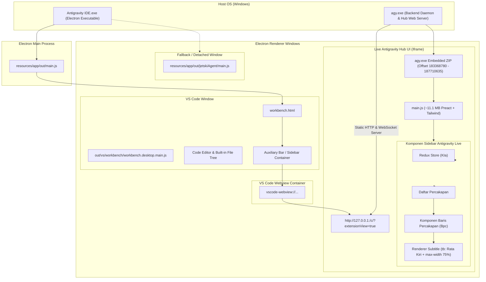

# Arsitektur Internal Antigravity IDE & Sistem Sidebar

Dokumen ini menjelaskan struktur arsitektur sistem Antigravity IDE, lapisan proses Electron, pemisahan tanggung jawab antara VS Code core dengan Antigravity UI, serta alur rendering daftar percakapan di sidebar.

---

## 🏛️ 1. Diagram Arsitektur Sistem

---

## 🔍 2. Penjelasan Lapisan Sistem

### A. Electron Main Process (`resources/app/out/main.js`)
Mengontrol siklus hidup aplikasi (*application lifecycle*), manajemen jendela (*window management*), protokol IPC, serta validasi awal sistem file.

### B. Lapisan VS Code Core (`workbench.desktop.main.js`)
File ini berukuran ~27 MB dan merupakan kode inti Microsoft Visual Studio Code:
- Teks editor Monaco.
- Tree view Explorer bawaan VS Code.
- Language Server Protocol (LSP).
- Terminal terintegrasi.

### C. Daemon & Web Server Antigravity (`agy.exe`)
File binary executable `C:\Users\<User>\.gemini\bin\agy.exe` (~210 MB):
- Berjalan di latar belakang dan otomatis dipanggil oleh Antigravity IDE saat workspace dibuka.
- **Bukan hanya daemon backend**, tetapi **juga bertindak sebagai HTTP & WebSocket server lokal** pada port dinamis (contoh: port 3671, 6445, 6631).
- Menyimpan aset web antarmuka Antigravity dalam format **ZIP archive tersemat (*embedded ZIP*)** di dalam body binary-nya (dimulai pada byte `183,368,780`).
- Menyajikan file `main.js` (~11.1 MB) yang merender antarmuka live sidebar dan chat di dalam VS Code.

> [!IMPORTANT]
> **Penemuan Kunci:**
> Inilah alasan mengapa modifikasi pada file `.js` di dalam direktori `resources/app/` tidak berefek pada sidebar yang sedang aktif. Sidebar aktif dimuat dari iframe server lokal yang dilayani langsung dari arsip ZIP di dalam binary `agy.exe`.

### D. Lapisan Fallback / Standalone (`jetskiAgent/main.js`)
File ini berukuran ~11.8 MB di dalam `resources/app/out/jetskiAgent/main.js`. Digunakan sebagai fallback atau saat agent dijalankan dalam mode window terpisah (*detached agent window*).

---

## 🔄 3. Alur Rendering Daftar Percakapan Live

1. **Inisialisasi Port Dinamis**:
   - `agy.exe` memilih port TCP bebas pada `127.0.0.1`.
   - VS Code webview mengarahkan `src` iframe ke `http://127.0.0.1:<port>/c/<uuid>?extensionView=true&...`.
2. **Pemuatan Bundle `main.js`**:
   - Iframe meminta `http://127.0.0.1:<port>/main.js`.
   - `agy.exe` membaca `main.js` dari ZIP tersemat dan mengirimkannya ke browser renderer.
3. **Redux Store Initialization (`KIa`)**:
   - Redux store dikonfigurasi. Kode patch menyuntikkan `window.__REDUX_STORE__ = y;` untuk mengekspos state proyek dan percakapan.
4. **Resolusi Path Proyek (`__getProjectFullPath`)**:
   - Fungsi resolusi mencari path lengkap dari:
     1. Map statis (`__WORKSPACES_MAP__`).
     2. `sidebarProjects` di Redux store.
     3. `trajectorySummaries` di Redux store berdasarkan conversation ID.
5. **Rendering Komponen Baris (`Bpc`)**:
   - Nilai subtitle `tb` dirender dengan:
     - `justify-content: flex-start`, `margin-right: auto` (Rata Kiri).
     - `max-width: 75%` (Memberikan ruang bernapas 25% di sebelah kanan).
     - `direction: rtl; text-align: left` (Menampilkan elipsis `...` di sebelah kiri saat path panjang, sementara folder proyek di kanan tetap terbaca).
