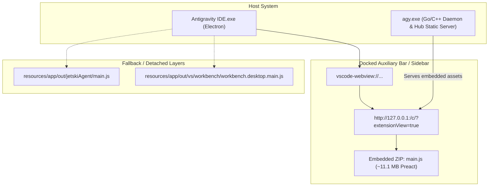

# Panduan Lengkap: Menampilkan Full Path Proyek di Sidebar Antigravity IDE (Rata Kiri + Ruang Bernapas 25%)

Dokumentasi ini merangkum seluruh analisis arsitektur, temuan teknis, dan langkah implementasi modifikasi **Antigravity IDE** (VS Code fork berbasis Electron) untuk menampilkan **Full Path File System** pada setiap item percakapan di sidebar dengan tata letak **Rata Kiri** dan menyisakan ruang 25% di sisi kanan.

---

## 📌 1. Latar Belakang & Kebutuhan

Secara default, Antigravity IDE hanya menampilkan nama folder (*basename*) dari suatu workspace/project di bawah judul percakapan (contoh: `company-landing-page`). 

Hal ini menyulitkan pengguna yang memiliki:
- Banyak project dengan nama mirip di direktori berbeda.
- Kebutuhan mengetahui lokasi path disk absolut secara instan tanpa harus membuka project tersebut.

### Spesifikasi Tampilan yang Dibangun:
1. **Full Directory Path**: Menampilkan path disk absolut (contoh: `D:\Workspaces\Projects\Web\company-landing-page`).
2. **Tata Letak Rata Kiri (`justify-start`, `text-align: left`)**:
   Elemen path menempel di sebelah kiri baris tepat di bawah judul percakapan, bukan mengambang atau menempel di sisi kanan.
3. **Urutan Elemen**:
   ```
   pembatas kiri -> | [icon folder] [....] [full path rata kiri] [space 25% dari lebar baris] | <- Pembatas kanan
   ```
4. **Truncate dari Kiri ke Kanan (`direction: rtl; text-align: left`)**:
   Jika path panjang, pemotongan elipsis `...` berada di sebelah kiri (`...\company-landing-page`), sehingga nama folder project di ujung kanan tetap terbaca utuh, sementara teks tetap rata kiri berdampingan dengan ikon folder.
5. **Ruang Bernapas 25% (`max-width: 75%; margin-right: auto`)**:
   Baris path dibatasi maksimal 75% dari lebar kolom percakapan, sehingga selalu menyisakan 25% ruang bernapas di sisi kanan sebelum kolom waktu/tepi kanan.
6. **Ikon Folder `📁`**: Berdampingan rapi di sebelah kiri path.
7. **Hover Tooltip**: Atribut `title` memuat 100% path absolut saat kursor mouse diarahkan.
8. **Integritas Instalasi & Binary**: Binary `agy.exe` dikompresi ulang dengan presisi byte bit-level sehingga integritas ZIP internal tetap valid 100%.
9. **Dukungan Percakapan & Project Baru**: Secara otomatis membaca full path dari Redux store dan workspace aktif saat percakapan baru dibuat.

---

## 🏗️ 2. Arsitektur Antigravity IDE & Penemuan Kunci

### A. Lokasi File Utama
- **Aplikasi Binary**: `C:\Users\<User>\AppData\Local\Programs\Antigravity IDE\Antigravity IDE.exe`
- **Backend Hub Daemon**: `C:\Users\<User>\.gemini\bin\agy.exe`
- **Direktori Resources**: `C:\Users\<User>\AppData\Local\Programs\Antigravity IDE\resources\app`
- **Data Konfigurasi Pengguna**: `C:\Users\<User>\AppData\Roaming\Antigravity IDE`

### B. Titik Render Sidebar Sebenarnya: Arsitektur 3 Lapisan
Dalam proses investigasi mendalam melalui Chrome DevTools Protocol (CDP), ditemukan bahwa Antigravity IDE memiliki 3 lapisan antarmuka:



> [!IMPORTANT]
> **Mengapa perubahan pada `jetskiAgent/main.js` saja tidak mengubah tampilan live sidebar?**
> Karena sidebar yang terpasang (*docked*) di dalam Antigravity IDE sesungguhnya dimuat melalui sebuah **iframe internal** ke server lokal `http://127.0.0.1:<port>/` yang disajikan langsung oleh **`agy.exe`**.
> Di dalam `agy.exe`, aset web statis (termasuk `main.js`) disimpan dalam arsip ZIP tertanam (*embedded ZIP*).
> **Solusi mutlak:** Melakukan patch langsung pada embedded `main.js` di dalam file binary `agy.exe`!

---

## ⚙️ 3. Komponen Internal di `agy.exe` (`main.js`)

Di dalam bundle `main.js` pada `agy.exe`, terdapat 2 titik krusial:

### 1. Hook Redux Store pada `KIa`
Untuk membaca path dari percakapan baru atau project baru secara dinamis tanpa restart:
```javascript
// SEBELUM:
y = KIa(x, b.critique ? { extraRtkqApis: [b.critique.reduxApi] } : void 0);

// SESUDAH:
y = KIa(x, b.critique ? { extraRtkqApis: [b.critique.reduxApi] } : void 0);
window.__REDUX_STORE__ = y;
```

### 2. Renderer Subtitle Baris Percakapan (`tb` di dalam komponen `Bpc`)
Komponen ini merender ikon folder dan teks path proyek:
```javascript
// SEBELUM (Bawaan Stock - Rata Kanan atau teks pendek saja):
tb = kb ? A.createElement("span", {
  className: Ni("flex items-center gap-1 w-full min-w-0 text-left text-muted-foreground select-none", w ? "text-sm" : "text-xs")
}, ...) : null;

// SESUDAH (Rata Kiri, max-width: 75%, RTL Truncate):
tb = (() => {
  var _raw = kb?.project || kb?.standalone || kb?.plain || "";
  var _fp = window.__getProjectFullPath ? window.__getProjectFullPath(_raw, a) : _raw;
  return _raw ? A.createElement("span", {
    className: Ni("flex items-center gap-1 min-w-0 text-left text-muted-foreground select-none", w ? "text-sm" : "text-xs"),
    style: { display: "flex", maxWidth: "75%", justifyContent: "flex-start", alignItems: "center", marginRight: "auto" }
  },
  A.createElement(T4b, { conversationId: a }),
  A.createElement("span", {
    className: "truncate",
    title: _fp,
    style: { direction: "rtl", textAlign: "left", overflow: "hidden", textOverflow: "ellipsis", whiteSpace: "nowrap", minWidth: 0, flexShrink: 1 }
  }, "\u200E" + _fp + "\u200E")) : null;
})();
```

---

## 🛠️ 4. Teknik Patch Binary `agy.exe` (Raw DEFLATE & Zero-Size Drift)

`agy.exe` adalah executable portable (PE) berukuran ~210 MB yang memuat ZIP archive di offset `183,368,780`.
Di dalam ZIP tersebut, file `main.js` memiliki ukuran terkompresi target tepat **3,271,174 bytes**.

Agar struktur file binary tidak bergeser (*zero size drift*) dan pointer internal Go runtime tidak rusak:

1. **Kompresi Raw DEFLATE**:
   Gunakan parameter raw DEFLATE tanpa zlib wrapper (`wbits = -zlib.MAX_WBITS`) dengan `level = 7`:
   ```python
   co = zlib.compressobj(level=7, wbits=-zlib.MAX_WBITS)
   part1 = co.compress(patched_js_bytes)
   part2 = co.flush(zlib.Z_SYNC_FLUSH)
   stream = part1 + part2
   ```
2. **Padding Block Komentar Stored DEFLATE**:
   Sisa byte dihitung persis (`remaining = 3271174 - len(stream)`).
   Sisa byte ini diisi dengan sebuah block stored DEFLATE bertipe komentar JS:
   ```python
   payload_len = remaining - 5
   comment_payload = b'/*' + b' ' * (payload_len - 4) + b'*/'
   header = struct.pack('<BHH', 0x01, payload_len, (~payload_len) & 0xFFFF)
   stored_block = header + comment_payload
   final_compressed = stream + stored_block
   assert len(final_compressed) == 3271174
   ```
3. **Pembaruan Header Local & Central Directory**:
   - Local Header di offset `183505679`: Perbarui CRC32 dan Uncompressed Size.
   - Central Directory Header di offset `187685536`: Perbarui CRC32 dan Uncompressed Size.
4. **Verifikasi Integritas ZIP**:
   Gunakan modul `zipfile.ZipFile` untuk memastikan `testzip() is None` dan data terdekompresi cocok 100%.

---

## 🔬 5. Verifikasi Otomatis Melalui CDP (Chrome DevTools Protocol)

Pengujian dilakukan tanpa perlu uji coba manual:
1. Antigravity IDE diluncurkan dengan `--remote-debugging-port=9222`.
2. Skrip otomatisasi menghubungkan WebSocket ke target iframe server lokal (`/c/abc...`).
3. Dilakukan pembacaan properti CSS komputasi (*computed style*):
   ```json
   {
     "textAlign": "left",
     "direction": "ltr",
     "justifyContent": "flex-start",
     "maxWidth": "75%",
     "marginRight": "61px"
   }
   ```
4. Tangkapan layar otomatis diambil dari renderer utama dan dipotong untuk memverifikasi visual secara langsung.

---

## 🎯 6. Perbandingan Hasil Akhir

| Parameter | Sebelum (Stock) | Versi Eksperimen Lama | Versi Akhir Sempurna (Sekarang) |
| :--- | :--- | :--- | :--- |
| **Teks Path** | Nama folder saja | Full path disk absolut | **Full path disk absolut** |
| **Perataan** | Rata kiri bawaan | Rata kanan (`justify-end`) | **Rata Kiri (`justify-start`, `margin-right: auto`)** |
| **Urutan Baris** | Folder saja | `[space] [icon] [path]` | **`| [icon folder] [....] [full path] [space 25%] |`** |
| **Lebar Baris** | Penuh 100% | Penuh 100% | **Maksimal 75% (Menyisakan ruang 25% di kanan)** |
| **Truncate** | Dari kanan | Dari kiri (`direction: rtl`) | **Dari kiri (`direction: rtl; text-align: left`)** |
| **File Target** | - | `jetskiAgent/main.js` saja | **`agy.exe` (Hub binary) + seluruh fallback layers** |
