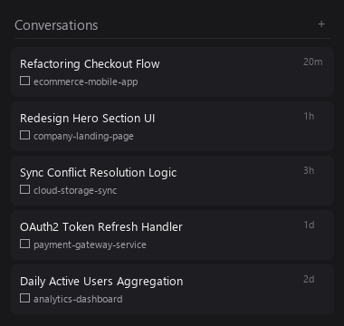
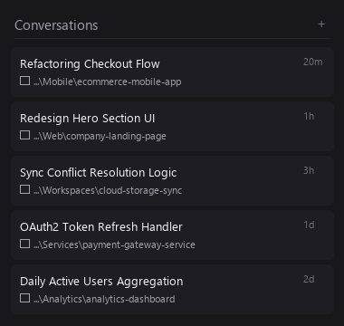

# Antigravity IDE - Full Path Sidebar Documentation

Kumpulan dokumentasi teknis dan panduan arsitektur untuk modifikasi antarmuka **Antigravity IDE** (VS Code fork berbasis Electron) guna menampilkan **Full File System Path** pada sidebar daftar percakapan (*Conversation List*).

---

## 📑 Daftar Isi Dokumentasi

| Dokumen | Deskripsi |
| :--- | :--- |
| [**FULL_PATH_SIDEBAR_MODIFICATION.md**](FULL_PATH_SIDEBAR_MODIFICATION.md) | Panduan komprehensif implementasi teknis, before-after, layout Rata Kiri + 25% space, dan alur perbaikan. |
| [**ARCHITECTURE.md**](ARCHITECTURE.md) | Analisis arsitektur Antigravity IDE (`agy.exe` Hub static server, Electron multi-process, iframe embedding, dan virtual list `LOo`). |
| [**IMPLEMENTATION_GUIDE.md**](IMPLEMENTATION_GUIDE.md) | Bedah kode sumber mendalam: komponen `Bpc` & `tb` di `agy.exe`, raw DEFLATE injection, Redux store hooking, dan Dynamic Resolver. |
| [**INTEGRITY_AND_CHECKSUM.md**](INTEGRITY_AND_CHECKSUM.md) | Sistem integritas VS Code/Electron, perhitungan hash SHA-256 base64, ZIP integrity checking, dan sinkronisasi `product.json`. |
| [**TROUBLESHOOTING.md**](TROUBLESHOOTING.md) | Log investigasi masalah, penemuan arsitektur `agy.exe` sebagai live webview host, dynamic port detection, CDP testing, dan solusinya. |
| [**FAQ.md**](FAQ.md) | Tanya jawab seputar percakapan baru, proyek baru, pembaruan aplikasi, dan rollback. |

---

## 🖼️ Tampilan Visual (Before vs After)

### Sebelum (Bawaan Stock)
Nama proyek terpotong hanya menampilkan nama folder saja (*basename*), tanpa kejelasan lokasi path di harddisk:


### Sesudah (Dengan Patch Rata Kiri + Ruang Bernapas 25%)
Menampilkan Full Path disk absolut, tata letak **RATA KIRI**, truncate dari kiri ke kanan (`direction: rtl; text-align: left`), menyisakan ruang bernapas 25% di sebelah kanan (`max-width: 75%`), ikon folder `📁`, dan tooltip hover path lengkap:


Urutan visual:
```
pembatas kiri -> | [icon folder] [....] [full path rata kiri] [space 25% dari lebar baris] | <- Pembatas kanan
```

---

## ⚡ Skrip Otomasi Terkait

Semua skrip otomasi berada pada root folder repository ini:
- [**patch_agy.py**](../patch_agy.py) : Skrip Python mandiri untuk memodifikasi binary `agy.exe` (Hub Web UI static server), memindai workspace, menyuntikkan layout Rata Kiri 75%, dan mengompresi ulang DEFLATE binary secara presisi.
- [**apply_patch.js**](../apply_patch.js) : Skrip satu-klik orkestrator yang menjalankan patch serentak pada `agy.exe`, `jetskiAgent/main.js`, `workbench.desktop.main.js`, checksum `product.json`, dan membersihkan cache V8.
- [**restore_backup.js**](../restore_backup.js) : Skrip rollback untuk mengembalikan file asli bawaan aplikasi (`agy.exe.original` dan JS backup) secara aman.

---

Dikembangkan dengan ❤️ oleh [ADR Programming](https://www.instagram.com/adr_programming/)

